<div align="center">


</div>

### `$ whoami`

`GET /v1/developers/nurfaidzy` → `200 OK`

```json
{
  "name": "Nurfaidzy Riyamizard Saragih",
  "location": "Jakarta, Indonesia",
  "role": "Frontend Developer",
  "firm": "PT Pinjaman Kemakmuran Rakyat",
  "yoe": "4+ years in Indonesian fintech",
  "shipped": [
    "internal portals & operational dashboards",
    "company websites with CMS",
    "data verification systems wired into government APIs"
  ],
  "principles": [
    "code humans can maintain",
    "systems that don't wake you at 3 AM"
  ],
  "motto": "Good enough code that solves real problems has infinite value"
}
```

Full-stack developer who has spent the last 4+ years inside Indonesian finance — lending, financing, and credit companies — currently frontend-focused with React & TypeScript, still full-stack when it counts.

<div align="center">

</div>

### `$ market-watch`

**Portfolio allocation — stack as holdings.**

| TICKER | ASSET | ALLOCATION | 4Y TREND |
|:---|:---|:---|:---|
| `TSX` | TypeScript | `████████▓░` 85% | ▲▲▲ |
| `NEXT` | Next.js | `████████▓░` 85% | ▲▲▲ |
| `RCT` | React | `████████▓░` 85% | ▲▲▲ |
| `TWND` | Tailwind CSS | `████████░░` 80% | ▲▲░ |
| `NODE` | Node.js | `███████▓░░` 75% | ▲▲░ |
| `PSQL` | PostgreSQL | `███████░░░` 70% | ▲▲░ |
| `EXPS` | Express.js | `██████░░░░` 60% | ▲▲░ |
| `NEST` | Nest.js | `█████▓░░░░` 55% | ▲░░ |
| `DCKR` | Docker | `█████▓░░░░` 55% | ▲▲░ |
| `SPRB` | Spring Boot | `███▓░░░░░░` 35% | ▲░░ |

<div align="center">
<a href="https://github.com/nurfaidzy"></a>
<a href="https://github.com/nurfaidzy"></a>
<a href="https://github.com/nurfaidzy"></a>
<a href="https://github.com/nurfaidzy"></a>
<a href="https://github.com/nurfaidzy"></a>
<a href="https://github.com/nurfaidzy"></a>
</div>

*Weights are vibes, not financial advice.*

<div align="center">

</div>

### `$ history`

**Position statement — where the experience compounds.**

| INSTRUMENT | POSITION | TENURE | SECTOR |
|:---|:---|:---|:---|
| **PT Pinjaman Kemakmuran Rakyat** | Frontend Developer | `Oct 2025 → present` | consumer lending |
| **PT Akulaku Finance Indonesia** | Fullstack Developer | `Oct 2022 → Sep 2025` | consumer financing |
| **PT Inovasi Kredit Indonesia (Itruzz)** | Fullstack Developer | `Feb 2023 → Nov 2023` | credit innovation |
| **Skill Academy by Ruangguru** | Front-End Engineer | `Feb 2022 → Jul 2022` | edtech |
| **Digital Talent Scouting (Kampus Merdeka)** | Participant | `Aug 2021 → Dec 2021` | govt program |

<div align="center">

</div>

### `$ chart --career`

<div align="center">



*Illustrative: scope & ownership over time.*

</div>

<div align="center">

</div>

### `$ stats --github`

<div align="center">


</div>

<div align="center">

</div>

### `$ contribution-graph --animated`

<div align="center">
<picture>
  <source media="(prefers-color-scheme: dark)" srcset="https://raw.githubusercontent.com/nurfaidzy/nurfaidzy/output/github-snake-dark.svg" />
  
</picture>
</div>

<div align="center">

</div>

### `$ connect`

<div align="center">
<a href="https://www.nurf.my.id"></a>
<a href="https://www.linkedin.com/in/nurfaidzy-riyamizard-saragih/"></a>
<a href="https://www.instagram.com/n_mizard"></a>
<a href="mailto:nurfaidzy@gmail.com"></a>
</div>

<div align="center">

</div>

<div align="center">

</div>
